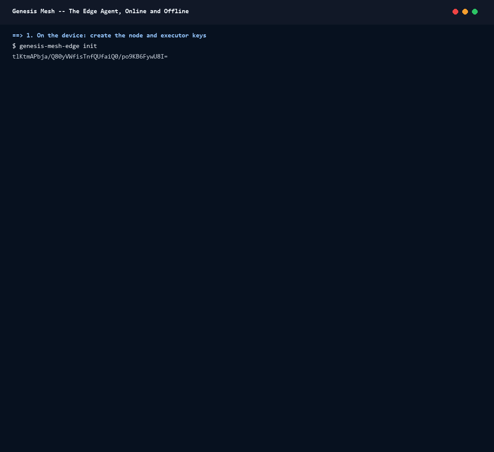

# Walkthrough: the edge agent, online and offline

This walkthrough runs `genesis-mesh-edge` (1.7.0, beta) against a local
Network Authority (NA) on one Linux machine. It enrols the agent with an
invite bound to its node key, gets a decision from the NA, stops the NA,
acts within a grant and then under break-glass, and starts the NA again to
watch the records upload. [docs/edge.md](../edge.md) is the reference for
every rule used here.



The GIF is a recording of [`record.sh`](../assets/edge-agent/record.sh); its
text is in [`session.txt`](../assets/edge-agent/session.txt).

## What you need

- Linux (the agent does not run on Windows), `curl` and `jq`.
- The Genesis Mesh core 1.7 for the NA and the operator's commands:
  `pip install "genesis-mesh>=1.7"`.
- The agent and the `edge_site` example of this repository, which issues
  the policy, the attestation and the grant with the SDK:

  ```sh
  cargo build --release -p genesis-mesh-edge --example edge_site
  export PATH="$PWD/target/release:$PWD/target/release/examples:$PATH"
  ```

## Setup: a local NA

Create a local NA as
[Develop Against a Local Network Authority](https://docs.genesismesh.org/sdk/local-network-authority.html)
describes, here on port 18444, and turn on the records of changes outside
the controlled path and grants, which the agent uses offline:

```sh
genesis-mesh init --config local/genesis-mesh.toml --home local/.genesis-mesh \
    --network-name EDGE-WALKTHROUGH --na-endpoint http://127.0.0.1:18444 \
    --na-port 18444 --env-file local/na.env
printf 'EVIDENCE_OUT_OF_BAND=on\nEVIDENCE_GRANTS=on\n' >> local/na.env
genesis-mesh na start --env-file local/na.env >>na.log 2>&1 &
NA_PID=$!
```

`edge_site` signs as the privileged operator key `init` created:

```sh
export NA_URL=http://127.0.0.1:18444
export OPERATOR_KEY="$(grep -v '^#' local/.genesis-mesh/keys/operator.key | tr -d '[:space:]')"
```

The agent's configuration pins the root public key of the NA's genesis
block, keeps its state in a directory of its own and listens on a Unix
socket open to your uid. The short heartbeat and retry intervals make it
notice the NA's return within seconds:

```sh
cat > edge.toml <<EOF
[authority]
url = "http://127.0.0.1:18444"
root_public_key = "$(jq -r .root_public_key local/.genesis-mesh/genesis.json)"

[node]
state_dir = "$PWD/state"
heartbeat_interval_seconds = 5

[snapshot]
retry_interval_seconds = 5

[local_api]
listen = "unix:$PWD/agent.sock"
allowed_uids = [$(id -u)]
EOF
export GM_EDGE_CONFIG="$PWD/edge.toml"
```

A local workload asks the agent with `POST /v1/authorize` and reports what
it did with `POST /v1/authorizations/{id}/outcome`. The helper `ask` does
both and prints the fields that matter here; `status` reads
`GET /v1/status`:

```sh
SOCK="$PWD/agent.sock"
ask() {
    local answer id
    answer="$(curl -s --unix-socket "$SOCK" -X POST http://agent/v1/authorize -d "$1")"
    echo "$answer" | jq -c '{allowed, authority, code}'
    if [ "$(echo "$answer" | jq -r .allowed)" = true ]; then
        id="$(echo "$answer" | jq -r .authorization_id)"
        curl -s --unix-socket "$SOCK" -X POST "http://agent/v1/authorizations/$id/outcome" \
            -d '{"outcome": "success"}' | jq -c '{record_kind, queued}'
    fi
}
status() { curl -s --unix-socket "$SOCK" http://agent/v1/status; }
```

## 1. Create the device's keys

```sh
genesis-mesh-edge init
```

`init` creates the state directory, the node key and the executor key, and
prints the node public key. Run again, it prints the same key.

## 2. Create an edge invite bound to that key

```sh
genesis-mesh admin invite --config local/genesis-mesh.toml --role client \
    --node-sovereign-id site7-17 --executor-resource-prefix edge:site7-17/ \
    --recipient-key "$(genesis-mesh-edge init)" > invite-token
```

The invite names the device's sovereign ID and the resource prefix its
executor key may act on. Bound to the node key, it can be redeemed by this
device only. To enrol a device again later, the order matters: `reset`,
`init` for the new key, then a new invite for that key, then `enroll`
([Starting again](../edge.md#starting-again)).

## 3. Enrol

```sh
genesis-mesh-edge enroll --invite-token-file invite-token 2>enroll.log; echo "exit $?"
genesis-mesh-edge status --json | jq -c "{enrolled, node_sovereign_id, executor_key_id, resource_prefix}"
```

`enroll` verifies the NA's key history from the root key, joins (the
executor key co-signs the request), verifies the certificate and checks
that the NA registered the executor key under the invite's prefix. Its log
lines go to stderr. `status --json` reads the state files.

## 4. Issue an attestation and a grant

```sh
ATT=$(edge_site attest site7-17 secret.rotate secret.revoke)
KEY=$(genesis-mesh-edge status --json | jq -r .executor_key_id)
edge_site grant "$KEY" "$ATT" secret.rotate
```

`attest` publishes and activates a policy over both capabilities (a
`lifetime_days` of at most 90) and issues an attestation to `site7-17`: the
NA decides the device's requests only under attestations issued to it.
Attestations come after the edge invite, since the NA refuses an invite for
a sovereign ID that is already an attestation's subject. `grant` gives the
executor key ten uses of `secret.rotate` over two hours, for a lifetime of
1 to 60 days; there is no grant for `secret.revoke`.

## 5. Run the agent: the NA decides

```sh
genesis-mesh-edge run 2>agent.log &
ROTATE='{"capability": "secret.rotate", "request_parameters": {"lifetime_days": 30}, "resource_id": "edge:site7-17/kv/db", "resource_action": "rotate"}'
ask "$ROTATE"
```

While the NA answers, it decides through the node route and the agent
verifies the decision: `authority` is `decision`, and the execution record
is submitted at once (`queued: false`). Wait for the agent's first sync
(`status | jq '.grants | length'` is 1) before you stop the NA, so that it
holds the grant.

## 6. Stop the NA: the grant, then break-glass

```sh
kill $NA_PID
ask "$ROTATE"
REVOKE='{"capability": "secret.revoke", "resource_id": "edge:site7-17/kv/old", "resource_action": "revoke"}'
ask "$REVOKE"
GLASS='{"capability": "secret.revoke", "resource_id": "edge:site7-17/kv/old", "resource_action": "revoke", "justification": "incident 42: the old key leaked"}'
ask "$GLASS"
status | jq -c "{na_state, pending_uploads}"
```

With the NA stopped, the connection is refused: the NA is unreachable, not
refusing ([Decision order](../edge.md#decision-order)).

- `secret.rotate` within the grant's envelope runs under the grant
  (`authority: grant`); its use is kept in the outbox (`queued: true`).
- `secret.revoke` has no grant. Without a justification the agent refuses it
  (`justification_required`).
- With a justification it runs under break-glass (`authority: break_glass`;
  `code: no_grant` says why no grant was used), and the record waits for
  the NA to judge it.

A `429` or `5xx` from the NA itself would not have led to break-glass: the
agent breaks the glass only when the NA gives no answer.

## 7. Start the NA again: the records upload

```sh
genesis-mesh na start --env-file local/na.env >>na.log 2>&1 &
NA_PID=$!
until [ "$(status | jq .pending_uploads)" = 0 ]; do sleep 1; done
status | jq -c "{connected, na_state, pending_uploads, dead_letters}"
```

The NA starts from the same settings and database. The agent retries every
`retry_interval_seconds` (doubling, up to 60 s) and, on reconnecting,
uploads the break-glass record and then the grant use in its chain's order.
`pending_uploads` reaches 0 with no dead letter. When you are done, stop the
agent (`kill %genesis-mesh-edge`) and the NA (`kill $NA_PID`).

## Rebuild the GIF

`record.sh` runs every command above in a temporary directory and prints
the session; `style.sed` adds the colour marks the renderer reads, without
changing the text:

```sh
cargo build --release -p genesis-mesh-edge --example edge_site
mkdir -p /tmp/gm-bin && ln -sf "$PWD/target/release/genesis-mesh-edge" "$PWD/target/release/examples/edge_site" /tmp/gm-bin/
BIN=/tmp/gm-bin bash docs/assets/edge-agent/record.sh > session.raw.txt
sed -E -f docs/assets/edge-agent/style.sed session.raw.txt > docs/assets/edge-agent/session.txt
python docs/assets/render_terminal_gif.py docs/assets/edge-agent/session.txt \
    docs/assets/edge-agent/edge-agent.gif --title "Genesis Mesh -- The Edge Agent, Online and Offline"
```

The IDs and keys differ on every run.
