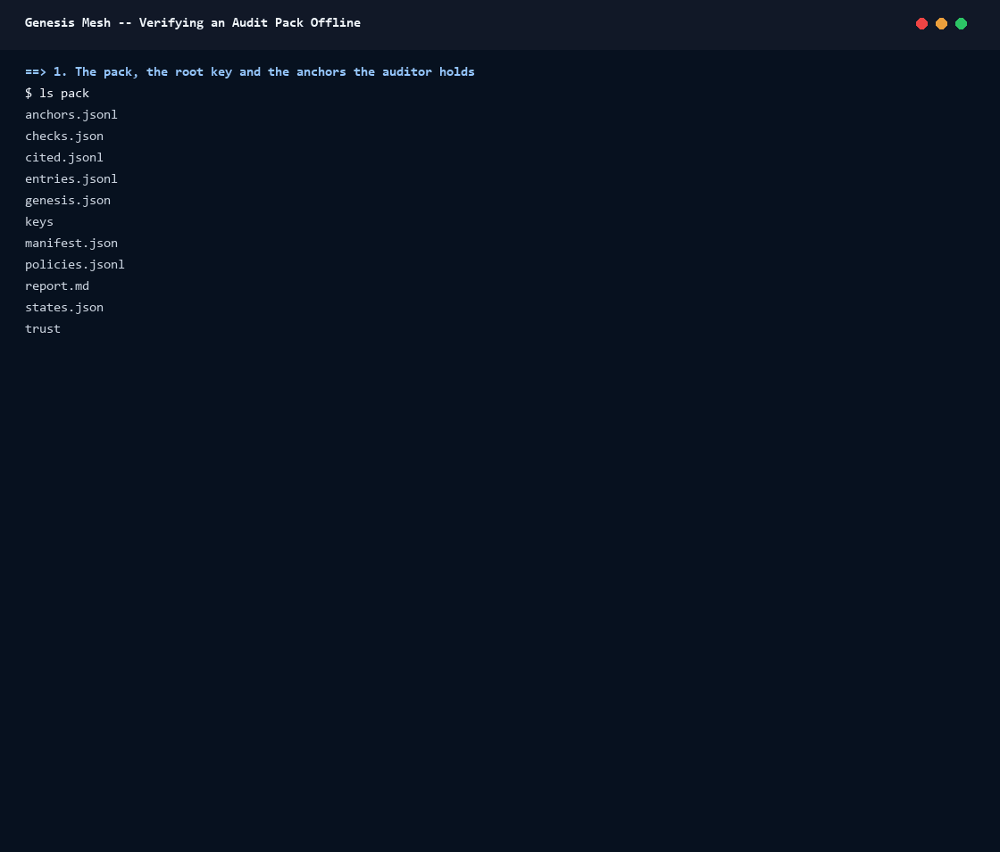

# Walkthrough: verifying an audit pack offline

This walkthrough verifies an audit pack with `genesis-mesh-verify`, changes
one byte of it, verifies it again, and runs the Python reference
(`genesis-mesh audit verify`) on the changed pack to show the same verdict.
It uses the frozen pack the verifier's tests use,
`tests/fixtures/audit-pack-1.5.0`. [docs/verifier.md](../verifier.md) is the
reference for the commands and the checks.



The GIF is a recording of [`record.sh`](../assets/verifier/record.sh); its
text is in [`session.txt`](../assets/verifier/session.txt).

## What you need

- `genesis-mesh-verify`: a release binary (check its signature first, see
  [Install](../verifier.md#install)), or a local build,
  `cargo build --release -p genesis-mesh-verify`.
- `jq`, and for the last step the Genesis Mesh core 1.5 or later
  (`pip install "genesis-mesh>=1.5"`).
- A copy of the fixture, so the repository's copy stays intact:

  ```sh
  cp -r tests/fixtures/audit-pack-1.5.0 /tmp/audit && cd /tmp/audit
  ```

The copy holds the pack (`pack/`), the root public key the auditor holds
(`root.pub`) and the store anchors the auditor kept outside the NA
(`anchors.json`). The keys inside a pack prove nothing alone: the NA's keys
are accepted only through the key history, from the root key you give.

## 1. Verify the pack

```sh
genesis-mesh-verify pack pack --anchor root.pub --known-anchors anchors.json; echo "exit $?"
```

The verifier checks the manifest and its signature, the key history from
the root key, the anchors, every entry and what the records rest on, then
renders the report and compares it with `report.md`. The pack is verified
(exit 0). The warning `cited_entry_unanchored` says that three entries the
pack cites from before its range verify by their signatures, but no prior
pack or held anchor places them in the store; `--prior` with the earlier
pack would.

## 2. Change one byte, and verify again

```sh
sed -i '3s/"exec_sequence_no":1/"exec_sequence_no":2/' pack/entries.jsonl
genesis-mesh-verify pack pack --anchor root.pub --known-anchors anchors.json --json | jq -c ".verified, .failures[]"; echo "exit ${PIPESTATUS[0]}"
```

The third entry's execution sequence number changes from 1 to 2. The
manifest, signed by the NA, holds the digest of every file, so the first
check fails: `manifest_digest_mismatch` on `entries.jsonl`, exit 1. A pack
whose manifest fails is not checked further.

## 3. The Python reference on the same pack

```sh
genesis-mesh audit verify pack --anchor root.pub --known-anchors anchors.json --format json | jq -c ".verified, .failures[]"; echo "exit ${PIPESTATUS[0]}"
```

The reference gives the same verdict, file and reason code. A difference
between the two is a bug in one of them
([Reading a mismatch](../verifier.md#reading-a-mismatch)).

## Rebuild the GIF

From the repository's root, with `genesis-mesh-verify` in a directory `BIN`
and `genesis-mesh` on the path:

```sh
BIN="$PWD/target/release" bash docs/assets/verifier/record.sh > session.raw.txt
sed -E -f docs/assets/verifier/style.sed session.raw.txt > docs/assets/verifier/session.txt
python docs/assets/render_terminal_gif.py docs/assets/verifier/session.txt \
    docs/assets/verifier/verifier.gif --title "Genesis Mesh -- Verifying an Audit Pack Offline"
```
